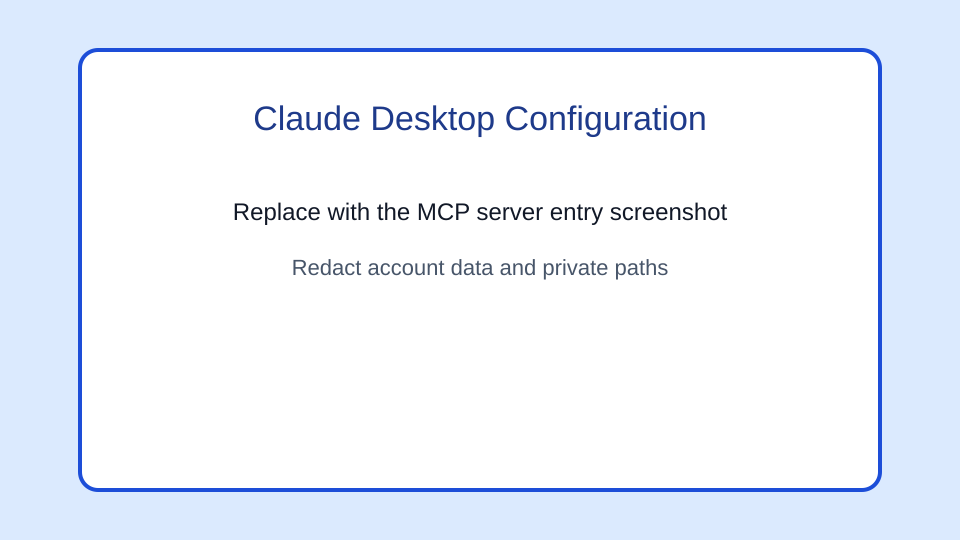
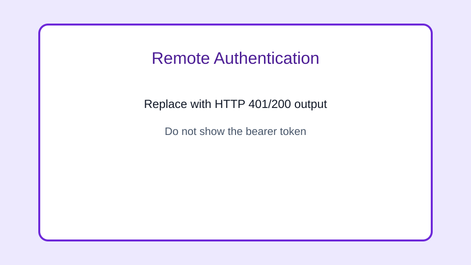

# MCP Guardian

> **Submission links**
>
> - CV: [`https://YOUR_CV_LINK`](https://YOUR_CV_LINK)
> - GitHub repository: [`https://github.com/YOUR_USERNAME/mcp-guardian`](https://github.com/YOUR_USERNAME/mcp-guardian)
> - Demo video: [`https://YOUR_VIDEO_LINK`](https://YOUR_VIDEO_LINK)
> - Live Claude Web endpoint: [`https://YOUR_PUBLIC_HOST/mcp`](https://YOUR_PUBLIC_HOST/mcp) — optional; add only while it is running and do not include any bearer token

**Status:** Claude Desktop stdio interception is implemented and manually
verified. The authenticated Streamable HTTP gateway is implemented and verified
locally. A public Claude Web endpoint and its actual connector recording are
deployment and recording steps that vary by the user's Claude account and
hosting setup.

MCP Guardian is a Python security gateway that holds MCP `tools/call`
requests until a user approves or blocks them. It supports:

- Claude Desktop through MCP stdio.
- Remote MCP clients, including Claude Web connectors, through authenticated
  Streamable HTTP.
- Independent concurrent approval decisions.
- Fail-closed timeout behavior.
- A PySide6 approval popup and macOS system-tray application.

Claude Web cannot be inspected by a local stdio process. MCP Guardian instead
provides a remote Streamable HTTP gateway that Claude Web connects to. A public
HTTPS reverse proxy or tunnel is still required for an actual Claude Web
connector; this repository does not claim that remote requests can be observed
when they bypass the gateway.

## Requirements

- macOS or another desktop OS supported by PySide6.
- Python 3.12 or newer.
- Claude Desktop for the local integration.
- `pip` and a virtual environment.

## Install

```bash
cd /Users/rabbani/Desktop/Projects/mcp-guardian
python3.12 -m venv .venv
source .venv/bin/activate
python -m pip install --upgrade pip
python -m pip install -r requirements.txt
```

Verify the environment:

```bash
python --version
python -c "import mcp, PySide6; print('MCP and PySide6 ready')"
```

## Run the Sample

The sample server is safe: it exposes only `get_server_status` and
`add_numbers`.

Start an allowed end-to-end stdio call:

```bash
.venv/bin/python examples/test_guardian_client.py --decision allow
```

Start a blocked end-to-end stdio call:

```bash
.venv/bin/python examples/test_guardian_client.py --decision block
```

An allowed call prints `isError: False` and executes the upstream tool. A
blocked call prints `isError: True` and the upstream server does not execute
the tool.

Run the desktop application:

```bash
.venv/bin/python -m app.main
```

The application opens a status window and places itself in the system tray.
Every pending tool call opens a top-level approval dialog.

## Claude Desktop Configuration

Open Claude Desktop's MCP configuration file:

```text
~/Library/Application Support/Claude/claude_desktop_config.json
```

Add or update the `mcp-guardian` entry:

```json
{
  "mcpServers": {
    "mcp-guardian": {
      "command": "/absolute/path/to/mcp-guardian/.venv/bin/python",
      "args": [
        "-m",
        "app.main",
        "--approval-mode",
        "manual"
      ],
      "env": {
        "PYTHONPATH": "/absolute/path/to/mcp-guardian",
        "PYTHONUNBUFFERED": "1"
      }
    }
  }
}
```

Fully quit and restart Claude Desktop. Claude will discover
`get_server_status` and `add_numbers` through Guardian. Approving a call
forwards it to the upstream server; blocking or timing out returns an MCP error
and prevents upstream execution.

## JSON Configuration

Copy the example configuration:

```bash
cp config/servers.example.json config/servers.json
```

Edit it as needed:

```json
{
  "upstream_command": "/absolute/path/to/mcp-guardian/.venv/bin/python",
  "upstream_args": [
    "/absolute/path/to/mcp-guardian/examples/sample_mcp_server.py"
  ],
  "upstream_name": "guardian-test-server",
  "approval_timeout": 120,
  "approval_mode": "manual",
  "transport": "stdio",
  "remote_host": "127.0.0.1",
  "remote_port": 8000,
  "remote_path": "/mcp",
  "bearer_token": null
}
```

Run with a configuration:

```bash
.venv/bin/python -m app.main --config config/servers.json
```

Command-line options override JSON values. The remote bearer token must contain
at least 16 characters.

## Remote Streamable HTTP Gateway

The remote gateway forwards only approved `tools/call` requests to a local
stdio upstream MCP server and exposes a Streamable HTTP endpoint to a remote
MCP client.

Start with a deterministic test approval:

```bash
.venv/bin/python -m app.main \
  --transport remote \
  --approval-mode allow \
  --host 127.0.0.1 \
  --port 8000 \
  --remote-path /mcp \
  --bearer-token "replace-with-a-strong-random-token"
```

Start with manual desktop approval:

```bash
.venv/bin/python -m app.main \
  --transport remote \
  --host 127.0.0.1 \
  --port 8000 \
  --remote-path /mcp \
  --bearer-token "replace-with-a-strong-random-token"
```

Example unauthenticated request:

```bash
curl -i http://127.0.0.1:8000/mcp
```

It should return `401 Unauthorized`. Include the bearer token as an
`Authorization: Bearer <token>` header for an MCP client.

### Claude Web Deployment

For an actual Claude Web connector:

1. Run MCP Guardian on a server or workstation that is reachable at deployment
   time.
2. Put it behind HTTPS, such as an authenticated reverse proxy or an HTTPS
   tunnel.
3. Keep the bearer token secret and configure the connector to use it.
4. Add the public Streamable HTTP URL, for example
   `https://gateway.example.com/mcp`, as a custom remote MCP connector.
5. Use desktop mode if approval decisions must appear on the local workstation.

Do not expose port `8000` directly to the public internet. Bind locally and
terminate TLS at a trusted proxy. Use DNS names and origin controls appropriate
for the deployment. A local stdio proxy alone cannot see or intercept arbitrary
existing Claude Web cloud-side connectors.

The supported boundary is explicit: requests must enter MCP Guardian's
Streamable HTTP endpoint. Connector traffic that bypasses that endpoint cannot
be observed or controlled by this project.

## Architecture

```text
Claude Desktop
  -> stdio MCP client
  -> Guardian low-level MCP server
  -> ToolInterceptor
  -> ApprovalManager
  -> PySide6 dialog
  -> Allow / Block
  -> upstream MCP server

Claude Web
  -> HTTPS public endpoint
  -> authenticated Streamable HTTP gateway
  -> ToolInterceptor
  -> ApprovalManager
  -> PySide6 dialog
  -> Allow / Block
  -> upstream MCP server
```

### Request Lifecycle

1. Claude sends a JSON-RPC `tools/call`.
2. Guardian verifies that the tool was discovered upstream.
3. Guardian creates an independent request ID and pending asyncio future.
4. The approval manager holds the future and optionally notifies the Qt UI.
5. The UI emits Allow or Block across the Qt/asyncio thread boundary.
6. The manager atomically resolves exactly once.
7. Approval forwards the original arguments upstream.
8. Block or timeout raises a protocol-level denial and prevents the upstream
   call.

The timeout, a UI crash, process cancellation, or transport failure is treated
as denial rather than approval.

## Demonstration

Demo video: [`https://YOUR_VIDEO_LINK`](https://YOUR_VIDEO_LINK)

The reviewer should be able to see all of the following in the recording:

1. The MCP Guardian desktop window and system tray.
2. Claude Desktop displaying a sample MCP tool.
3. MCP Guardian displaying the server, tool name, request ID, and arguments.
4. **Allow:** the upstream server executes and Claude receives the result.
5. **Block:** Claude receives a denial and the upstream execution marker is absent.
6. Optional: the remote endpoint rejecting a request without a bearer token.
7. Optional: an authenticated Claude Web/Streamable HTTP request reaching the
   approval popup and completing or blocking correctly.

### Screenshots

<!-- Replace each placeholder image with a real screenshot from docs/screenshots/. -->

**Desktop approval window**


**Allow result**


**Block result**


**Claude Desktop MCP configuration**



**Remote authentication result**



You can either create the `docs/screenshots/` directory and replace these
placeholders, or delete the sections that do not have an image yet. Do not
commit screenshots containing bearer tokens or private Claude data.

## Security Behavior

- Remote HTTP requires bearer authentication.
- Every approval request has a unique UUID.
- Concurrent requests have independent futures and decisions.
- Duplicate decisions do not override the first decision.
- Timeout defaults to 120 seconds and fails closed.
- Closing an approval dialog is treated as Block.
- Sensitive keys such as passwords, secrets, tokens, cookies, private keys,
  and API keys are redacted in the shared redaction helper.
- MCP arguments remain visible in the approval dialog because the user must be
  able to inspect them.
- Non-discovered upstream tools are rejected.
- The gateway does not execute tools in deterministic allow/block test mode
  until the approval manager authorizes the call.

For production use, replace the bearer token with a properly deployed identity
and authorization system, restrict network exposure, enable TLS, and add
persistent audit logs and replay protection.

## Testing

Run all tests:

```bash
.venv/bin/python -m pytest -q
```

The suite covers:

- Approval, block, timeout, and cancellation.
- Independent concurrent decisions.
- Tool interceptor behavior.
- Stdio proxy discovery and forwarding.
- Blocked and unknown proxy tools.
- JSON configuration validation.
- Sensitive-argument redaction.
- Remote bearer authentication.

Current local test status:

```text
19 tests passed
```

The local test suite does not replace real Claude Desktop or real Claude Web
verification. It verifies the approval engine and HTTP behavior deterministically.

### End-to-End Claude Desktop Verification Checklist

- [ ] Claude Desktop starts MCP Guardian from the absolute Python path.
- [ ] Claude discovers `get_server_status` and `add_numbers`.
- [ ] An Allow popup forwards `add_numbers(10, 20)`.
- [ ] The result contains `result: 30.0`.
- [ ] The upstream execution marker is present after Allow.
- [ ] A Block popup prevents upstream execution.
- [ ] The upstream execution marker is absent after Block.
- [ ] The request timeout fails closed.
- [ ] Two simultaneous calls produce two independent request IDs.

### Claude Web Verification Checklist

- [ ] Guardian runs on `127.0.0.1:8000`.
- [ ] HTTPS is provided through a tunnel or reverse proxy.
- [ ] The public endpoint ends in `/mcp`.
- [ ] Requests without a bearer token return `401`.
- [ ] Authenticated MCP initialization succeeds.
- [ ] `tools/list` exposes the expected sample tools.
- [ ] Claude Web is configured to use Guardian rather than bypassing it.
- [ ] A remote Allow call executes upstream.
- [ ] A remote Block call is denied and does not execute upstream.

## Project Layout

```text
app/
  approval/       independent approval futures and decisions
  core/           configuration and logging/redaction
  desktop/        PySide6 window, dialog, tray, and Qt bridge
  gateway/        stdio proxy and tool interception
  remote/         authenticated Streamable HTTP gateway
examples/         harmless upstream server and integration client
config/           JSON configuration example
tests/            pytest and pytest-asyncio coverage
```

## Claude Desktop Troubleshooting

### Claude cannot find the server

- Verify the absolute Python and project paths.
- Restart Claude Desktop completely.
- Confirm `.venv/bin/python -m app.main --approval-mode block` starts.
- Check logs in Claude Desktop and stderr output.

### No approval popup appears

- Re-enable the app in macOS and ensure PySide6 can open windows.
- Use the system tray menu to show the Guardian window.
- Check that `--approval-mode manual` is active.

### The upstream tool is not executed

- Block mode, timeout, cancellation, UI failure, and denial all prevent
  execution.
- Check the upstream server and application logs.
- Verify the tool name exists in `list_tools`.

## Clean Repository

Runtime artifacts are excluded by `.gitignore`, including virtual environments,
pytest caches, logs, build directories, and environment files.

## Submission Checklist

- [ ] Replace the CV, GitHub, demo video, and optional public endpoint placeholders.
- [ ] Record the Allow and Block demonstration.
- [ ] Add unredacted-free screenshots to `docs/screenshots/`.
- [ ] Remove placeholder text from the live links.
- [ ] Add a license if the repository is intended for public use.
- [ ] Add a real public GitHub remote and push the repository.
- [ ] Verify that `.venv/`, bearer tokens, private configuration, and Claude
      Desktop account data are not committed.
- [ ] Run `.venv/bin/python -m pytest -q` immediately before submission.
- [ ] Submit the CV, GitHub repository link, and demo video link using the
      assignment form.

## License

License: **PLACEHOLDER — choose an appropriate license before public release.**