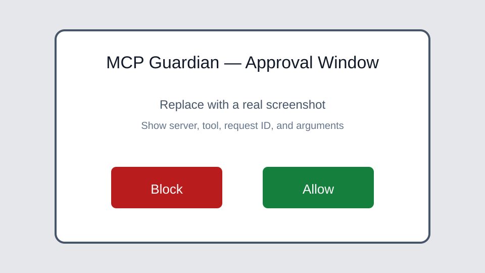
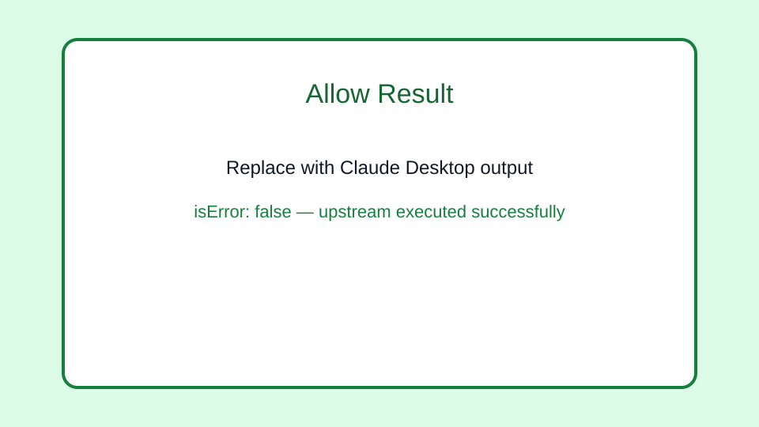
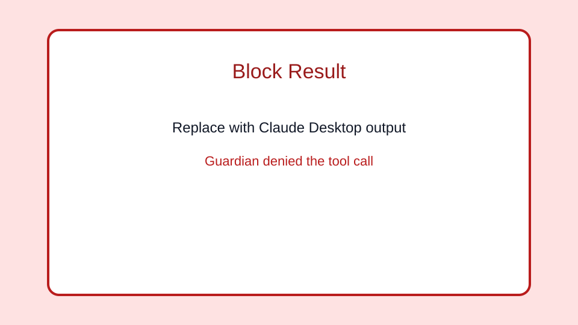

# MCP Guardian

MCP Guardian is a Python gateway that adds a human approval step before MCP tool execution. It sits between an MCP client and an upstream MCP server, intercepts tool requests, displays them to the user, and forwards them only after approval.

## What It Does

- Intercepts MCP `tools/call` requests before they reach the upstream server.
- Displays the server, tool name, arguments, and request ID in a PySide6 approval dialog.
- Forwards approved requests and returns an MCP error for blocked requests.
- Handles concurrent approvals independently.
- Fails closed when a request times out or is cancelled.
- Supports Claude Desktop over stdio and remote MCP clients over authenticated Streamable HTTP.
- Uses Bearer token authentication for remote connections.

The sample upstream server exposes two harmless tools: `get_server_status` and `add_numbers`.

## Architecture

### Claude Desktop (Local stdio)

```text
Claude Desktop
    |
    | MCP stdio
    v
Guardian MCP Server
    |
    v
Tool Interceptor
    |
    v
Approval Manager
    |
    v
PySide6 Approval Dialog
    |
    | Allow / Block
    v
Upstream MCP Server
```

Guardian starts the upstream server and discovers its available tools. When Claude calls a tool, Guardian creates a unique pending approval and waits for the user's decision.

- **Allow:** The request is forwarded to the upstream MCP server and its result is returned to Claude.
- **Block:** The request is denied without executing the upstream tool.

### Remote MCP Clients (Claude Web)

```text
Claude Web
    |
    | HTTPS + Bearer Token
    v
Cloudflare Tunnel
    |
    | Forward to localhost:8000
    v
Guardian Streamable HTTP Gateway
    |
    v
Tool Interceptor
    |
    v
Approval Manager
    |
    v
PySide6 Approval Dialog
    |
    | Allow / Block
    v
Upstream MCP Server (stdio)
```

Claude Web runs remotely and cannot directly access a local stdio gateway. Guardian provides a Streamable HTTP endpoint, which can be exposed securely using Cloudflare Tunnel.

The tunnel forwards public HTTPS requests to Guardian running locally at `http://127.0.0.1:8000`.

Requests sent directly to other MCP connectors do not pass through Guardian and cannot be monitored or intercepted by it.

## Requirements

- Python 3.12 or newer.
- Claude Desktop for local desktop integration.
- A desktop environment supported by PySide6 for interactive approvals.
- Cloudflare Tunnel (`cloudflared`) for remote Claude Web access.
- An active internet connection for remote access.

## Installation

Clone the repository and navigate to the project directory:

```bash
git clone https://github.com/ghulamrabbani883/guardian-mcp
cd mcp-guardian
```

Create and activate a virtual environment:

```bash
python3.12 -m venv .venv
source .venv/bin/activate
```

Install dependencies:

```bash
python -m pip install --upgrade pip
python -m pip install -r requirements.txt
```

## Run Guardian

### Start the Desktop Application

```bash
.venv/bin/python -m app.main
```

Guardian opens its status window and system-tray icon. Approval dialogs appear whenever the gateway receives tool calls.

## Configure Claude Desktop

Add the following entry to your Claude Desktop MCP configuration file.

On macOS:

```text
~/Library/Application Support/Claude/claude_desktop_config.json
```

Configuration:

```json
{
  "mcpServers": {
    "mcp-guardian": {
      "command": "/absolute/path/to/mcp-guardian/.venv/bin/python",
      "args": ["-m", "app.main"],
      "env": {
        "PYTHONPATH": "/absolute/path/to/mcp-guardian",
        "PYTHONUNBUFFERED": "1"
      }
    }
  }
}
```

Replace both paths with the absolute paths for your checkout.

Restart Claude Desktop. It should discover the following tools through Guardian:

- `get_server_status`
- `add_numbers`

Call either tool to trigger the approval dialog.

## Claude Web: Remote Streamable HTTP with Cloudflare Tunnel

Claude Web runs remotely and cannot directly access a local stdio gateway. Guardian solves this by exposing its local Streamable HTTP endpoint through a Cloudflare Tunnel.

Cloudflare Tunnel securely forwards public HTTPS requests to Guardian running locally at `http://127.0.0.1:8000`. No public IP address or direct exposure of port `8000` is required.

### 1. Install Cloudflare Tunnel

On macOS, install `cloudflared` using Homebrew:

```bash
brew install cloudflared
```

Verify the installation:

```bash
cloudflared --version
```

For other operating systems, follow the [official Cloudflare installation guide](https://developers.cloudflare.com/tunnel/get-started/).

### 2. Configure Guardian

From the project root, create the runtime configuration:

```bash
cp config/servers.example.json config/servers.json
```

Generate a private Bearer token:

```bash
python -c "import secrets; print(secrets.token_urlsafe(32))"
```

Edit `config/servers.json` and configure the following values. Replace the paths with absolute paths for your checkout and paste your generated token.

```json
{
  "upstream_command": "/absolute/path/to/mcp-guardian/.venv/bin/python",
  "upstream_args": [
    "/absolute/path/to/mcp-guardian/examples/sample_mcp_server.py"
  ],
  "upstream_name": "guardian-test-server",
  "approval_timeout": 120,
  "approval_mode": "manual",
  "transport": "remote",
  "remote_host": "127.0.0.1",
  "remote_port": 8000,
  "remote_path": "/mcp",
  "bearer_token": "YOUR_PRIVATE_TOKEN"
}
```

The `config/servers.json` file is ignored by Git. Never commit or share your private token.

### 3. Start MCP Guardian

Open a terminal in the project directory and start Guardian:

```bash
.venv/bin/python -m app.main --config config/servers.json
```

Keep Guardian running.

It starts the local MCP endpoint at:

```text
http://127.0.0.1:8000/mcp
```

The desktop approval interface will also open.

### 4. Expose Guardian Using Cloudflare Tunnel

Open a second terminal and run:

```bash
cloudflared tunnel --url http://127.0.0.1:8000
```

Cloudflare creates a temporary public HTTPS URL. The terminal will display something similar to:

```text
https://random-words-here.trycloudflare.com
```

Copy the generated URL and append `/mcp`:

```text
https://random-words-here.trycloudflare.com/mcp
```

This is the public MCP endpoint that Claude Web will connect to.

Keep both Guardian and `cloudflared` running while using the connector. The Quick Tunnel URL changes when a new tunnel is started.

**Note:** Cloudflare Quick Tunnels are intended for development and testing. They do not require a Cloudflare account or custom domain. For a persistent hostname, configure a named Cloudflare Tunnel instead.

### 5. Verify the Public Endpoint

Before connecting Claude Web, verify that the public endpoint accepts authenticated MCP initialization requests.

Run this from the project directory, replacing the URL with your actual Cloudflare Tunnel URL:

```bash
.venv/bin/python - <<'PY'
import json
from pathlib import Path
import httpx

config = json.loads(Path("config/servers.json").read_text())

response = httpx.post(
    "https://YOUR_PUBLIC_TUNNEL_HOST/mcp",
    headers={
        "Authorization": f"Bearer {config['bearer_token']}",
        "Accept": "application/json, text/event-stream",
    },
    json={
        "jsonrpc": "2.0",
        "id": 1,
        "method": "initialize",
        "params": {
            "protocolVersion": "2025-03-26",
            "capabilities": {},
            "clientInfo": {
                "name": "curl-check",
                "version": "1.0"
            },
        },
    },
)

print("HTTP", response.status_code)
print(response.text)
PY
```

Expected response:

```text
HTTP 200
```

The response should contain `serverInfo.name` set to `mcp-guardian`.

Opening the URL directly in a browser is not an equivalent test. An unauthenticated browser request should be rejected with `401 Unauthorized`.

### 6. Configure Claude Web

Open Claude Web and navigate to the remote MCP connector configuration.

1. Enter your Cloudflare public HTTPS URL ending in `/mcp`.
2. Select **No sign-in** in the connector sign-in/OAuth step. Do not enter an OAuth Client ID.
3. Select **Bearer token** as the authorization method.
4. Enter the same private token configured in `config/servers.json`.
5. Save and connect the MCP server.
6. Verify that `get_server_status` and `add_numbers` are discovered.
7. Call either tool and approve or block the request using the Guardian desktop dialog.

The connector adds the Bearer authorization scheme to the supplied token.

Guardian does not implement OAuth client registration. Authentication is handled through the configured Bearer token.

### 7. Test the Complete Remote Flow

Once Claude Web is connected:

- Call `get_server_status` or `add_numbers`.
- Guardian intercepts the incoming `tools/call` request.
- A desktop approval dialog displays the server, tool name, arguments, and request ID.
- Select **Allow** to forward the request to the upstream MCP server.
- Select **Block** to deny execution and return an MCP error.

The upstream tool executes only when the request is approved.

## Sample Allow/Block Test

The sample client runs Guardian as a subprocess with deterministic decisions:

### Allow a Tool Request

```bash
.venv/bin/python examples/test_guardian_client.py --decision allow
```

The upstream sample tool executes and its result is returned.

### Block a Tool Request

```bash
.venv/bin/python examples/test_guardian_client.py --decision block
```

Guardian denies the request and returns an MCP error. The upstream tool is not executed.

## Testing

Run the complete test suite:

```bash
.venv/bin/python -m pytest -q
```

The test suite covers:

- Approval decisions.
- Approval timeouts.
- Concurrent requests.
- Tool interception and forwarding.
- Configuration validation.
- Argument redaction.
- Remote Bearer authentication.

## Security Considerations

- Guardian fails closed when an approval times out or is cancelled.
- Remote connections require Bearer token authentication.
- Keep the Bearer token private and out of version control.
- Never expose port `8000` directly to the public internet.
- Use HTTPS through Cloudflare Tunnel.
- Keep Guardian's approval timeout enabled.
- Stop the Cloudflare Tunnel when it is no longer required.
- Requests sent directly to other MCP connectors do not pass through Guardian and cannot be intercepted by it.

Cloudflare Quick Tunnels are suitable for demonstrations and development, not production deployments.

## Known Limitations and Trade-offs

- Interactive approval requires a running desktop environment with PySide6.
- Remote requests still depend on the local Guardian process and upstream MCP server being available.
- Cloudflare Quick Tunnel URLs are temporary and change when the tunnel is restarted.
- Guardian only intercepts requests routed through its gateway.
- Guardian does not implement OAuth client registration.
- Approval dialogs require a human decision, which introduces latency into tool execution.
- Cloudflare Quick Tunnels have development-oriented limitations, including a 200 concurrent-request limit and no support for Server-Sent Events (SSE). Test the actual Streamable HTTP behavior before relying on Quick Tunnels for more demanding workloads.

## Demonstration

Video: [ADD_DEMO_VIDEO_URL]

### Screenshots

Add actual screenshots of the approval interface and request results below.







